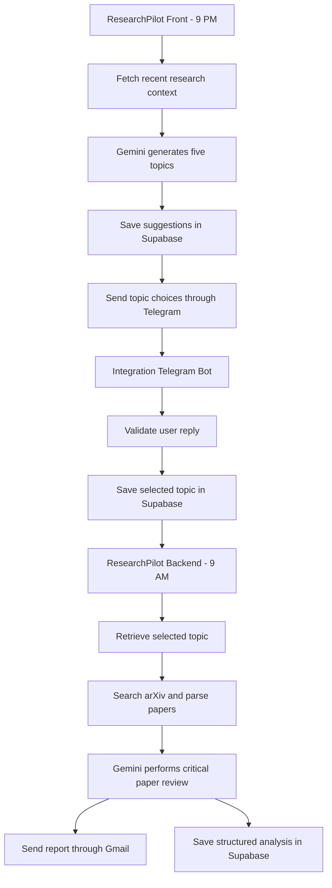

# ResearchPilot

ResearchPilot is an AI-powered research workflow built with **Make.com, Google Gemini, Supabase, Telegram, arXiv, and Gmail**.

It automates two connected stages of an academic research workflow:

1. **Research topic discovery:** generates five personalized research topics every day and asks the user to select one through Telegram.
2. **Research paper analysis:** retrieves papers related to the selected topic, performs a focused critical review, emails the report, and stores the results in Supabase.

## Live Make.com Scenarios

The following links open the publicly shared Make.com scenario blueprints.

| Scenario | Responsibility | Public link |
|---|---|---|
| **ResearchPilot Front** | Scheduled topic discovery: fetches recent research context, generates five suggestions with Gemini, stores them in Supabase, and sends the options to Telegram. | [View ResearchPilot Front](https://eu1.make.com/public/shared-scenario/HnN4tlmWq4o/research-pilot-front) |
| **Integration Telegram Bot** | Handles Telegram replies, validates the user's topic selection, rejects invalid input, and records the selected topic. | [View Integration Telegram Bot](https://eu1.make.com/public/shared-scenario/gUMV9dxKcZO/integration-telegram-bot) |
| **ResearchPilot Backend** | Retrieves the selected topic, searches arXiv, parses paper data, uses Gemini for critical analysis, sends the email report, and stores research results in Supabase. | [View ResearchPilot Backend](https://eu1.make.com/public/shared-scenario/Fvn22Rd6d4j/research-pilot-backend) |

> These are public scenario-inspection links, not links to a hosted ResearchPilot web application. They allow visitors to inspect the shared Make.com scenarios.

## System Architecture



## Workflow Overview

### 1. ResearchPilot Front — 9:00 PM

- Retrieves recent research activity and previously stored research context from Supabase.
- Sends the context to Gemini.
- Generates exactly five research topic suggestions:
  - Three topics deepen the user's recent research direction.
  - Two topics explore related but different research areas.
- Saves the suggestions in the `suggested_topics` table.
- Sends the five numbered choices to the user's Telegram chat.

### 2. Integration Telegram Bot — event-driven

- Watches for incoming Telegram messages.
- Checks whether a topic-selection session is awaiting a response.
- Extracts a valid choice from 1 to 5, including a number embedded in a simple natural-language reply (for example, `I like 4`).
- Rejects invalid or ambiguous replies and asks the user to enter a valid number from 1 to 5.
- Saves the corresponding topic in `selected_topics`.
- Closes the selection state after a successful selection so later messages cannot overwrite that selection.
- A new scheduled topic batch opens the next selection opportunity.

### 3. ResearchPilot Backend — 9:00 AM

- Retrieves the selected research topic from Supabase.
- Searches arXiv for relevant research papers.
- Fetches and parses paper metadata and XML content.
- Uses Gemini to conduct a focused critical review, emphasizing methodology verification, genuine drawbacks, possible improvements, and research opportunities.
- Sends the consolidated report through Gmail.
- Stores the research summary and structured analysis in Supabase for future reference.

## Technology Stack

| Component | Technology | Purpose |
|---|---|---|
| Workflow automation | Make.com | Scheduling, routing, API orchestration, and data processing |
| Generative AI | Google Gemini | Topic generation and critical paper analysis |
| Database | Supabase / PostgreSQL | Suggested topics, selected topics, and research records |
| User interaction | Telegram Bot API | Topic delivery and human selection |
| Paper discovery | arXiv API | Research paper search and retrieval |
| Email delivery | Gmail | Delivery of research analysis reports |

## Human-in-the-Loop Design

ResearchPilot does not automatically decide which research direction to analyze. Gemini proposes five options, but the user makes the final selection through Telegram.

The selection workflow is designed to:

- Accept a clear choice from 1 to 5.
- Handle a number embedded in a short message when the choice is unambiguous.
- Reject text with no valid choice or multiple conflicting choices.
- Keep a completed selection closed until the next scheduled batch.

## Repository Structure

The documentation repository is organized as follows:

```text
ResearchPilot-docs/
├── README.md
├── architecture.md
├── backend-paper-analysis.md
├── database.md
├── frontend-topic-discovery.md
├── prompts.md
├── screenshots.md
├── setup.md
├── testing.md
├── screenshots/
│   ├── email1.png
│   ├── Integration_Telegram_Bot.png
│   ├── ResearchPilot_Backend.png
│   ├── ResearchPilot_front.png
│   ├── summary_email.png
│   └── telegram_chat.png
└── workflows/
    ├── back.md
    ├── front.md
    └── trigger.md
```

## Documentation Guide

| File | Contents |
|---|---|
| [architecture.md](architecture.md) | Overall system architecture and scenario interaction |
| [frontend-topic-discovery.md](frontend-topic-discovery.md) | Frontend Gemini topic-discovery prompt |
| [backend-paper-analysis.md](backend-paper-analysis.md) | Backend Gemini paper-analysis prompt |
| [database.md](database.md) | Supabase tables and data design |
| [prompts.md](prompts.md) | Prompt documentation index |
| [setup.md](setup.md) | Setup and configuration notes |
| [testing.md](testing.md) | Testing and validation notes |
| [screenshots.md](screenshots.md) | Screenshot index and visual evidence |
| [workflows/front.md](workflows/front.md) | ResearchPilot Front scenario |
| [workflows/trigger.md](workflows/trigger.md) | Telegram selection scenario |
| [workflows/back.md](workflows/back.md) | ResearchPilot Backend scenario |

## Screenshots

The [`screenshots/`](screenshots/) directory contains visual evidence of the Make.com workflows, Telegram interaction, and generated email reports. See [screenshots.md](screenshots.md) for the image index.

## Security Considerations

- Never commit Gemini API keys, Telegram bot tokens, Supabase secret keys, or service-role keys.
- Keep credentials inside Make.com connections or secure environment/configuration storage.
- Review Supabase Row Level Security policies and grant only the permissions required by each workflow.
- Check public Make.com scenario pages for exposed personal information or sensitive mapped values before sharing.
- Do not use public scenario sharing as a method of distributing credentials.

## Project Notes

The public Make.com links provide a way to inspect the three automation scenarios. The documentation describes the workflow design and observed behavior; exact module settings, database policies, and connection permissions should always be verified in the live Make.com and Supabase projects.
