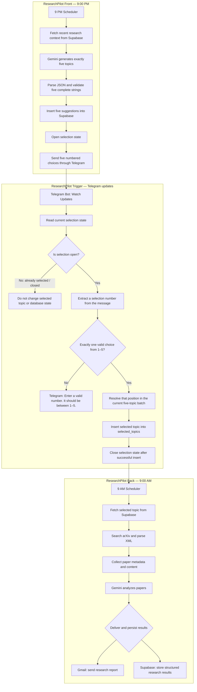

# System Architecture

ResearchPilot is implemented as three connected Make.com scenarios. The workflow combines automated topic discovery, a Telegram-based human selection step, and scheduled academic-paper analysis.

## End-to-end workflow



## Scenario responsibilities

| Scenario | Trigger | Responsibility |
|---|---|---|
| **Front** | Daily schedule, 9:00 PM | Retrieve recent research context, generate five suggestions, store them, open the selection window, and send the Telegram choices. |
| **Trigger** | Telegram Bot — Watch Updates | Check whether selection is open, interpret the user's reply, validate the choice, store one selected topic, and close the selection window. |
| **Back** | Daily schedule, 9:00 AM | Retrieve the selected topic, find and parse arXiv papers, analyze them with Gemini, email the report, and persist structured results in Supabase. |

## Topic-selection behavior

### Natural-language number extraction

The Telegram reply does not have to consist of a single digit only. The workflow can extract a valid selection number when it appears in ordinary text.

Examples:

| User message | Expected behavior while selection is open |
|---|---|
| `4` | Select option 4. |
| `I like 4` | Extract `4` and select option 4. |
| `I think option 2 is best` | Extract `2` and select option 2. |
| `hi` | No valid choice is found; send the validation message. |
| `0` or `7` | Invalid choice; send the validation message. |
| `I like 2 and 4` | Ambiguous multiple choices; reject and ask for one number. |

The parser must avoid treating digits inside larger numbers (for example, `14`) as valid choices. If a message contains more than one candidate selection, it should be treated as ambiguous rather than silently choosing one.

### Invalid input while selection is open

If no single valid option from 1–5 can be extracted, the bot replies:

> Enter a valid number. It should be between 1–5.

Invalid input must not create a selected-topic row or close the selection window. The user can try again.

### One successful selection per batch

After a valid choice is successfully inserted into `selected_topics`, the workflow closes the selection state.

Once selection is closed:

- Later Telegram messages cannot replace or modify the selected topic.
- Later messages cannot create another selection for the same batch.
- The closed-state check prevents further selection-side database mutations.
- A new selection becomes possible only after the next topic batch is opened by the Front scenario.

This is a one-selection-per-batch rule. The Back scenario reads the saved selection; it does not depend on later Telegram messages.

## Human-in-the-loop design

Gemini proposes five candidate directions, but the user makes the final choice through Telegram. This keeps topic discovery automated while retaining human control over which direction proceeds to paper retrieval and analysis.

## State management

The selection workflow uses a Supabase-backed state flag referred to in the design as `awaiting_selection`.

Intended state transition:

```text
awaiting_selection = false
        |
        | Front stores a new five-topic batch
        v
awaiting_selection = true
        |
        | User submits one valid choice and it is saved
        v
awaiting_selection = false
```

Rules:

- Open selection only after the five suggestions are successfully stored.
- Keep selection open after invalid input.
- Close selection only after the selected topic is successfully inserted.
- When closed, ignore selection attempts for that completed batch and do not modify the saved selection.
- Tie the choice to the current batch so an old reply cannot select from a newer batch.

## Research report delivery and persistence

After Gemini analyzes the retrieved papers, the Back scenario sends the generated report through Gmail and stores the structured analysis in Supabase.

These are two output destinations for the same analysis:

1. **Gmail:** a readable report delivered to the user.
2. **Supabase:** structured records such as paper metadata, summaries, methodology, drawbacks/limitations, research gaps, future directions, and paper links, according to the deployed schema.

Persisting the structured output allows future ResearchPilot runs to reuse earlier research context, compare topics, and reduce repeated recommendations.

The Gmail delivery and Supabase insert are separate operations. Production error handling should make failures visible and support retrying the failed destination without creating duplicate records or duplicate emails.

## Timezone and schedule

The intended schedule is:

- **9:00 PM:** generate and send five topic suggestions.
- **9:00 AM the following morning:** retrieve the selected topic and perform paper research and analysis.

**To confirm before public release:** verify that both Make.com scenarios use the intended `Asia/Dhaka` timezone and that the actual schedules match these times.
