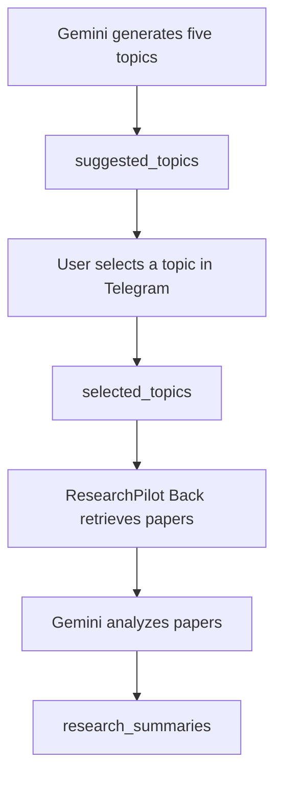

# Database Design

ResearchPilot uses Supabase (PostgreSQL) for three documented data tables:

1. `suggested_topics` — candidate topics generated by Gemini.
2. `selected_topics` — topics selected by the user through Telegram.
3. `research_summaries` — research summaries and paper-analysis output.

The schemas below are transcribed from the Supabase Table Editor screenshots supplied for this documentation. The screenshots show column names and PostgreSQL data types; they do not expose every constraint, default, index, or RLS policy. Those details are deliberately not guessed.

## 1. `suggested_topics`

**Purpose:** Stores the five topic suggestions generated by ResearchPilot Front. The `active` flag is used to identify whether a suggestion is currently active/available in the workflow.

| Column | PostgreSQL type | Observed details |
|---|---|---|
| `id` | `int8` (`BIGINT`) | Key icon is shown in the Table Editor. |
| `topic` | `text` | Stores the suggested topic text. |
| `active` | `bool` (`BOOLEAN`) | A sample row shows `TRUE`. |

**Observed sample:** one displayed row has `id = 69`, `topic = "This is active"`, and `active = TRUE`.

**Data-format requirement:** `topic` should contain the plain topic string, not a serialized Make.com collection such as `{"value":"...","__IMTINDEX__":...}`.

## 2. `selected_topics`

**Purpose:** Stores the topic selected by the user through the Telegram selection workflow. The table also records when the topic was selected and whether the row is active.

| Column | PostgreSQL type | Observed details |
|---|---|---|
| `id` | `int8` (`BIGINT`) | Key icon is shown in the Table Editor. |
| `topic` | `text` | Stores the selected topic text. |
| `selected_at` | `timestamptz` (`TIMESTAMP WITH TIME ZONE`) | Sample values include a timezone-aware timestamp. |
| `active` | `bool` (`BOOLEAN`) | Displayed sample rows show `TRUE`. |

**Observed sample rows:** IDs `1`, `10`, and `11` are visible. The corresponding topic values include `ResNet`, a Physics-Informed Neural Networks topic, and a Memory-Efficient Small Language Models topic.

## 3. `research_summaries`

**Purpose:** Stores research-analysis results produced by ResearchPilot Back. The visible columns include the selected/researched topic, a summary, the creation timestamp, paper drawbacks, and paper titles with links.

| Column | PostgreSQL type | Observed details |
|---|---|---|
| `id` | `int8` (`BIGINT`) | Key icon is shown in the Table Editor. |
| `topic` | `text` | Topic associated with the research analysis. |
| `summary` | `text` | Research summary text. |
| `created_at` | `timestamptz` (`TIMESTAMP WITH TIME ZONE`) | Sample values are timezone-aware timestamps. |
| `drawbacks_of_paper` | `text` | Stores drawbacks/limitations extracted or summarized for the analyzed paper(s). |
| `paper_titles_with_link` | `text` | Stores paper title information and links. |

**Observed sample rows:** IDs `3` through `13` are visible in the screenshot, with some gaps in the sequence. The table contains topic, summary, drawback, and paper-title/link content.

## Data flow between the tables

- `suggested_topics` is the candidate pool shown to the user.
- `selected_topics` records the user's chosen research direction.
- `research_summaries` stores the resulting research analysis for future retrieval and topic discovery.

## Data integrity and implementation notes

### Store plain text in text columns

The screenshots show some `research_summaries` rows where text fields appear to begin with serialized JSON such as `{"topic": ...}`. This suggests that, for those records, a Make.com collection/object may have been mapped into a `text` column instead of mapping the specific text value.

For new records:
- Map the actual topic string into `topic`.
- Map the actual summary string into `summary`.
- Map the intended drawbacks text into `drawbacks_of_paper`.
- Map the intended paper-title/link text into `paper_titles_with_link`.

Do not map an entire bundle or collection into a text column unless storing serialized JSON is intentional.

### ID handling

The screenshots show `int8` ID columns and non-contiguous example IDs. This is normal for generated database identifiers: deleting a row does not automatically renumber the remaining IDs. Treat IDs as stable identifiers, not display positions. Use an ordered query or `ROW_NUMBER()` for presentation numbering rather than rewriting stored primary keys.

### Selection consistency

The application-level workflow should ensure that:
- A new topic batch is stored before the Telegram selection message is sent.
- A valid selection is stored in `selected_topics`.
- One batch can produce only one successful selection.
- The selected topic is not overwritten by later Telegram messages after the selection window closes.

### Security

Review Row Level Security (RLS) policies separately for each table. Public read access should only be enabled where intended. Never publish Supabase service-role keys, secret keys, Telegram bot tokens, or Gemini API keys in the repository.

## Schema details still to verify

The screenshots do not show the following database metadata. Confirm these from Supabase SQL or the table definition before publishing exact setup SQL:

- Whether each `id` column is `PRIMARY KEY` and which identity/default-generation rule it uses.
- Whether `topic`, `summary`, and other text columns are `NOT NULL`.
- Whether `active` has a database default of `TRUE` on each table.
- Whether `selected_at` and `created_at` have `DEFAULT now()`.
- RLS enablement and policies for all three tables.
- Any indexes, unique constraints, foreign keys, or triggers.

Once these details are confirmed, add the exact DDL to a `database/schema.sql` file so another user can reproduce the database.
